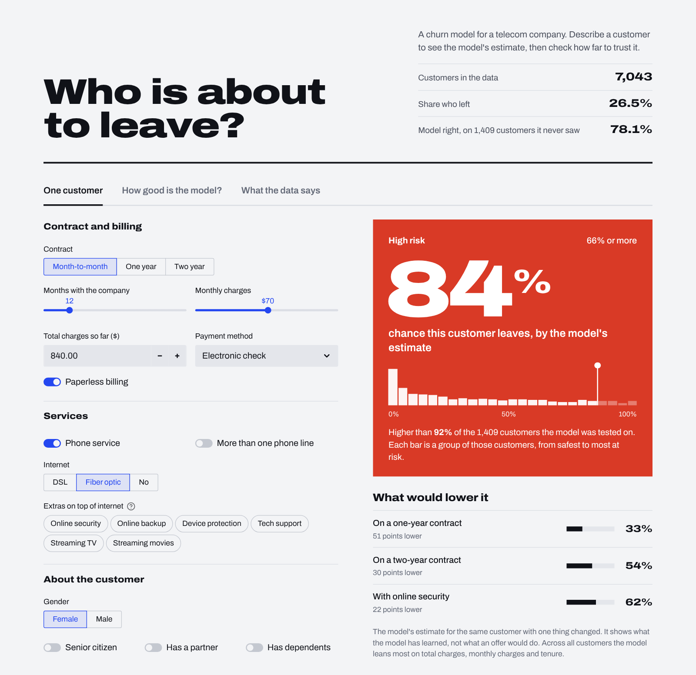
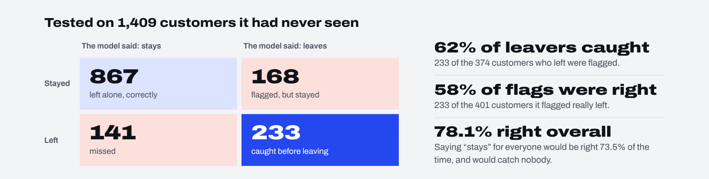

# Customer Churn Prediction 📉

[](https://github.com/rebekaolar-cyber/churn-project/actions/workflows/ci.yml)


End-to-end ML pipeline that predicts telecom customer churn from behavioral and
account data, served through an interactive Streamlit dashboard — so retention
efforts can target at-risk customers *before* they leave.



## Problem

Businesses lose revenue to churn they could have predicted. This model flags
at-risk customers early so retention spend is targeted rather than scattered.

## Results

Random Forest with SMOTE-balanced training, evaluated on a held-out 20% test set
(1,409 customers) from the [Telco Customer Churn dataset](https://www.kaggle.com/datasets/blastchar/telco-customer-churn):

| Metric | Score |
| --- | --- |
| Accuracy | 78% |
| ROC-AUC | 0.82 |
| Churn recall | 0.62 |
| Churn precision | 0.58 |

Top predictors: total charges, monthly charges, tenure and contract type.

## The dashboard

- **One customer.** Describe an account (contract, billing, services) and the model's estimate
  updates as you go: the chance the customer leaves, where that sits among the 1,409 test
  customers, and which single change would lower it most. Those "what if" figures are the
  model's own estimates for the changed account; they show what it has learned, not what an
  offer would do.
- **How good is the model?** Its four outcomes on customers it never saw, in plain words
  (caught, missed, flagged by mistake, left alone), the ROC curve, and the inputs it weighs most.
- **What the data says.** How many customers left, and how leaving relates to contract length,
  tenure and price.



Colour means one thing throughout: red is leaving, blue is staying, amber is in between.

## Project structure

```
churn-project/
├── src/churn/            # Installable package
│   ├── config.py         # Paths & constants (env-overridable)
│   ├── data_prep.py      # Load → clean → encode → split → save
│   ├── train.py          # SMOTE + Random Forest (optional grid search)
│   ├── bootstrap.py      # Builds artifacts on first deploy
│   ├── profile.py        # A described customer → the model's columns; what-if options
│   ├── ui.py             # The dashboard's look: colours, styles, HTML blocks, chart style
│   └── dashboard.py      # Streamlit app (wires the two above to the page)
├── static/               # The dashboard's font and icon, served by the app itself
├── tests/                # pytest suite (99% coverage)
├── notebooks/            # 01_eda, 02_preprocessing (exploration)
├── data/
│   ├── raw/              # telco_churn.csv
│   └── processed/        # train/test splits (generated)
├── streamlit_app.py      # Streamlit Cloud entrypoint
├── pyproject.toml        # Package, pytest, ruff, mypy config
├── requirements.txt      # Runtime deps (used by Streamlit Cloud)
└── requirements-dev.txt  # + test/lint/type tooling
```

## Tech stack

Python · pandas · NumPy · scikit-learn · imbalanced-learn · Streamlit · Plotly ·
pytest · ruff · mypy · GitHub Actions

## Setup

```bash
python -m venv venv && source venv/bin/activate
pip install -r requirements-dev.txt
pip install -e .
```

## Usage

```bash
# 1. Build train/test splits from the raw CSV
python -m churn.data_prep

# 2. Train the model (add tune=True in code for a grid search)
python -m churn.train

# 3. Launch the dashboard
streamlit run streamlit_app.py
```

Steps 1–2 are optional locally: the dashboard's bootstrap builds any missing
artifacts from `data/raw/telco_churn.csv` on first launch.

Paths can be redirected without code changes via `CHURN_DATA_DIR` and
`CHURN_MODELS_DIR` environment variables.

## Testing & quality

```bash
pytest          # tests + coverage gate (fails under 80%)
ruff check .    # lint
mypy            # static type check
```

CI runs all three on Python 3.11–3.13 for every push and pull request
(see [`.github/workflows/ci.yml`](.github/workflows/ci.yml)).

## Deployment (Streamlit Community Cloud)

The app is deploy-ready — no committed model binary required; it trains from the
committed raw data on first boot.

1. Push this repo to GitHub.
2. Go to [share.streamlit.io](https://share.streamlit.io) and sign in with GitHub.
3. **New app** → select this repo and branch.
4. Set **Main file path** to `streamlit_app.py` and deploy.

Streamlit Cloud installs `requirements.txt` automatically. First boot runs the
bootstrap (preprocess + train), then the dashboard caches the model for the
container's lifetime.

## Author

Rebeka Natalia Olar · [github.com/rebekaolar-cyber](https://github.com/rebekaolar-cyber)

Font: Archivo, under the SIL Open Font License 1.1 (licence text in `static/fonts/`).
